# Enchant Transfer

<div align="center">

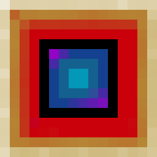

<!-- AUTO:badges -->


[](https://www.curseforge.com/minecraft/mc-mods/enchant-transfer)
[](https://modrinth.com/mod/enchant-transfer)
<!-- /AUTO:badges -->

**Extract, transfer, and combine enchantments through Magic Cards — now with colored cards, attachable modules, and an XP conversion system.**

[Website](https://arensis.github.io/enchant-transfer-mod/) · [CurseForge](https://www.curseforge.com/minecraft/mc-mods/enchant-transfer) · [Modrinth](https://modrinth.com/mod/enchant-transfer) · [Issues](https://github.com/arensis/enchant-transfer-mod/issues)

</div>

---

**Enchant Transfer** adds a craftable block — the **Transfer Table** — that lets you extract enchantments from any item into individual **Magic Cards**, apply those cards to other compatible items, and combine two cards of the same enchantment and level to upgrade them. All operations are free (no XP cost), and vanilla enchantment compatibility rules are respected.

Version 2.0 introduced the **Module System**: specialized blocks that attach to the Transfer Table on any face, extending its capabilities. The first module — the **Infusion Coil** — converts Magic Cards into stored XP and fills glass bottles into Bottles o' Enchanting.

> **Version support:** New features and modules are developed for Minecraft 26.x only.
> The 1.21.11 version (v2.0.x) is in maintenance mode and will only receive critical bug fixes.

<!-- AUTO:version-table -->
| Mod version | Minecraft | Status |
|-------------|-----------|--------|
| **3.1.x** | 26.2 | Active development |
| **2.0.x** | 1.21.11 | Maintenance (critical bug fixes only) |
<!-- /AUTO:version-table -->

**Requires:** Fabric Loader and Fabric API

**Languages:** English · Español · Português (Brasil)\* · Русский\* · 简体中文\* · Français\* · Deutsch\* · 日本語\* — **New:** Français, Deutsch and 日本語

> \* Pending review by a native speaker (Portuguese, Russian, Chinese, French, German and Japanese). Do you speak one of them? Help us review the translations or add your own language: open an [issue](https://github.com/arensis/enchant-transfer-mod/issues) or a pull request editing the [language files](https://github.com/arensis/enchant-transfer-mod/tree/master/src/main/resources/assets/enchanttransfer/lang).

---

## Core Features

### Extract

Place any enchanted item or book in the Transfer Table to strip its enchantments into individual Magic Cards, each one color-coded by category.

### Apply

Place a Magic Card and a target item in the Transfer Table. The enchantment transfers instantly, respecting vanilla incompatibility rules.

**Shift + click** a card in your inventory and it goes straight onto the item on the table, if the item accepts it and it doesn't clash with its enchantments. Otherwise it goes to the combine slots, the stack split evenly between both (the odd card stays in your inventory) — with an item on the table, only when the cards make a pair that can level up.

### Combine

Two cards of the same enchantment and level produce one card of the next level (up to vanilla maximum). Stacks work too — 5 + 6 cards yields 5 upgraded and 1 remainder.

### Zero Cost

All Transfer Table operations — extraction, application, and combination — are completely free. No XP, no materials consumed.

---

## Typed Magic Cards

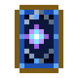 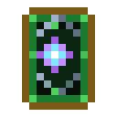 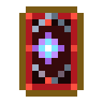 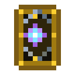 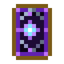 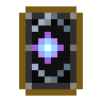

Magic Cards are now color-coded by enchantment category. When you extract an enchantment, the Transfer Table automatically produces a card of the matching color.

| Card | Category | Enchantments |
|------|----------|-------------|
| 🔵 Blue | Protection | Protection, Fire Protection, Blast Protection, Projectile Protection, Feather Falling |
| 🟢 Green | Nature | Respiration, Aqua Affinity, Depth Strider, Silk Touch, Fortune, Luck of the Sea, Lure, Harvesting\* |
| 🔴 Red | Combat | Sharpness, Smite, Bane of Arthropods, Impaling, Looting, Thorns, Sweeping Edge, Knockback, Density, Breach, Lunge, Power, Punch, Multishot, Piercing |
| 🟡 Yellow | Utility | Efficiency, Unbreaking, Quick Charge, Swift Sneak, Magnetism\* |
| 🟣 Purple | Arcane | Channeling, Riptide, Loyalty, Frost Walker, Wind Burst, Fire Aspect, Flame, Infinity, Mending, Soul Speed |
| ⚫ Black | Curse | Curse of Vanishing, Curse of Binding |

\* Added by this mod, see [Enchantments](#enchantments-).

---

## Enchantments 🆕

Two new enchantments, from the Enchanting Table, villagers and loot — and, like any other, extractable into Magic Cards.

### Magnetism

**Utility · I–V · metal armor** (chainmail, iron, copper, gold, netherite). Worn, it pulls nearby items and XP orbs toward you: 4 / 6 / 8 / 10 / 12 blocks (the highest level you wear counts). Sneak to switch it off; items you throw yourself are left alone.

### Harvesting

**Nature · I–IV · hoes and axes.** It only works when you carry what it replants — the crop's seed or the tree's sapling — and spends one per plant.

| Level | Hoe — right-click a ripe crop | Axe — break a log of a natural tree |
|-------|-------------------------------|-------------------------------------|
| I | Harvests it and replants it | Replants the sapling where the base log was |
| II | Also the next two crops ahead (a row of 3) | Also fells the logs straight above |
| III | The whole connected field, for **0.5 XP levels per started 9×9** | The whole tree, branches included, for **0.5 XP levels** |
| IV | Grows every replanted crop with bone meal from your inventory (doubles the field's XP cost) | Grows the replanted sapling into a tree with bone meal from your inventory |

- **Wear**: 1 durability per crop or log, like tilling or chopping. **Sneak** to harvest a single crop or chop a single log.
- **XP cost**: 0.5 levels by default, set per world with the game rules `enchanttransfer:harvesting_field_xp_cost` and `enchanttransfer:harvesting_tree_xp_cost` (0 makes it free).
- **Not enough XP**: the field is cut to the 9×9s you can pay for (or a row if not even one), and a tree falls like level II.
- **Safe for builds**: it only fells trees whose logs touch leaves that grew there, not leaves placed by a player (up to 256 logs).
- **Crops and trees from other mods**: any crop built on vanilla's crop block works out of the box; others can be added to the `#enchanttransfer:harvesting_replantable` block tag (or left out with `harvesting_excluded`). Trees whose logs and leaves are in `#minecraft:logs` and `#minecraft:leaves` are felled, and the sapling comes from datapack rules in `data/<namespace>/enchanttransfer/harvesting_sapling/` — `{"logs": "mymod:maple_log", "sapling": "mymod:maple_sapling"}` — or, without one, from the name (`maple_log` → `maple_sapling`). They reload with `/reload`.

---

## Card Decks

     

A **Card Deck** is a brass-bound case that stores Magic Cards of one type. Place decks in a **Deck Lectern** within an Enchanting Table's normal bookshelf range (same positions and air gap as regular bookshelves, but **at the table's own height**) and the table's rolls shift according to what you've stored.

| Deck | Stores | Effect on nearby Enchanting Tables |
|------|--------|-----------------------------------|
| Protection / Nature / Combat / Utility / Arcane | Cards of that color | Favors that category, and even more the exact enchantments stored |
| Rarity (wildcard) | Curse cards | Favors rare enchantments (weight ≤ 2) |

### Crafting Recipe

|   |   |   |
|:-:|:-:|:-:|
|   | <br>Brass Ingot |   |
| <br>Leather | <br>Card of the deck's type | <br>Leather |
|   | <br>Brass Ingot |   |

→  **Card Deck** × 1 — the card is consumed and sets the deck's type (Rarity: a Curse card)

### How it works

- **Storing**: right-click a card onto the deck (or the deck onto a card), like a bundle. Right-click with an empty cursor to take the last stack back out.
- **Deck screen**: right-click with a deck in hand to open it — its cards in a grid, with a points bar and a reserve bar — and move cards in and out at a glance (Shift + click works). The 64-point limit still applies. The deck's tooltip also shows its reserve and each worn card's.
- **Points**: a level N card is worth 2^(N-1) points (same ratio as combining). Each deck holds up to 64 points.
- **Enchanting power**: a full Deck Lectern counts as **two bookshelves** — the two that would stack in its column (every 3 decks holding cards = 2 bookshelves). They add up with regular bookshelves, and the vanilla cap of 15 still applies — so higher enchantment levels come from power, just like with bookshelves; 8 full lecterns alone reach level 30.
- **Balance**: the bias is relative — a library with every category in equal parts barely changes anything; a specialized one makes its category up to ×3 more likely. Every card favors its category; only max-level cards (Efficiency V, Fortune III, Silk Touch I…) also favor their exact enchantment, up to ×15 in all. Strength builds up with the points stored — fast at first, so even a few level I cards show, and in full with one full deck (64 points); more decks don't raise it further, but add reserve and power.
- **Location affinity**: some decks resonate with where the table is — Combat ×2 in the Nether, Fire/Blast Protection ×1.5 and Arcane fire (Fire Aspect, Flame) ×2 in the Nether, Rarity ×1.5 in the Nether, Arcane ×2 in the End, Nature's water enchantments ×1.5 in oceans and rivers Fortune/Silk Touch ×1.5 in forests, jungles and taigas, and Harvesting ×1.5 in plains. It scales the deck's extra effect (capped at ×3). Rules are datapack JSON in `data/<namespace>/enchanttransfer/library_affinity/`, so modpacks can add their own dimensions and biomes (`deck`, optional `dimension`, `biome`, `enchantments`, and `multiplier`); they reload with `/reload`.
- **Wear**: decks pay, in card reserve, only for what their bonus brings in — not for what the table would have rolled anyway, nor for what comes from the decks' power. Each card holds as much reserve as the points it takes (a level V card holds 16, so a full deck always holds 64); worn cards show it as a bar. Each marked enchantment costs 20% of a max-level card of it, scaled by the level obtained (Efficiency V: 3.2, Efficiency III: 1.92, Silk Touch I: 0.2): in full when max-level cards of it are in the decks, half for a category or Rarity bonus. It's split among the deck kinds that boosted it, in proportion to their boost, and taken first from a card already started, then from the lowest-level ones. An option the decks can't pay for is disabled. Worn cards work normally at the Transfer Table, and combining two adds up what they had left.
- **Influence mark**: options changed by the decks show a small card in their top-right corner and an *Influenced by card decks* line in their tooltip.

> **No marks? That's normal.** Decks tilt the odds, they don't pick for the table: when it would have rolled the same enchantment anyway, the option isn't marked and costs no card. Some rolls show no marks at all — you'll see more with fuller, more specialized decks and higher table levels. The rolls only change after you enchant something, so re-placing the item shows the same options.

### Deck Lectern


The block that holds your decks: a low brass base with a tilted velvet tray for **3 decks**, under a glass bell.

- **Placement**: only counts **at the same height as the enchanting table**. Its glass bell fills the whole column, so **nothing can be placed on top of it** (and it can't go under a block) — that's why it's worth two bookshelves.
- **Right-click** opens a small screen with 3 deck slots. Hovering the amethyst gem shows what the lectern gives a table on its own, next to each maximum: each category's and max-level enchantment's factor, the power and the wear reserve.
- **Lamps**: one per slot — dark brown (no deck), light (deck without cards), emerald (deck with cards).
- **Off by default.** Shift + right-click switches it on (it needs at least one deck with cards) or off, so you choose which lecterns count; the amethyst on top of the bell glows while it's on. It switches itself off when its decks run out of cards, but never on.
- While active, runes fly from the lectern to the enchanting table, like with bookshelves.
- Place lecterns where regular bookshelves would go around an Enchanting Table (same positions and air gap). One ring of 16 at table height already reaches the cap of 15, so they don't need to be stacked.

|   |   |   |
|:-:|:-:|:-:|
| <br>Glass | <br>Amethyst Shard | <br>Glass |
| <br>Brass Ingot | <br>Redstone | <br>Brass Ingot |
| 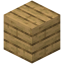<br>Planks | <br>Planks | <br>Planks |

→  **Deck Lectern** × 1

---

## Module System

The Transfer Table now works as a **hub**. Specialized module blocks can be placed on any of its 6 faces. Right-click the Transfer Table to open the **Selector Screen** — a visual hub showing all connected modules with their real-time status.

- Up to **6 modules** per Transfer Table (one per face)
- Each module type adds different functionality
- Navigate between the hub and any module using the **dot navigation bar**
- Modules show live status in the Selector — processing progress, tank levels, and connection state

### GUI Screens

<p>
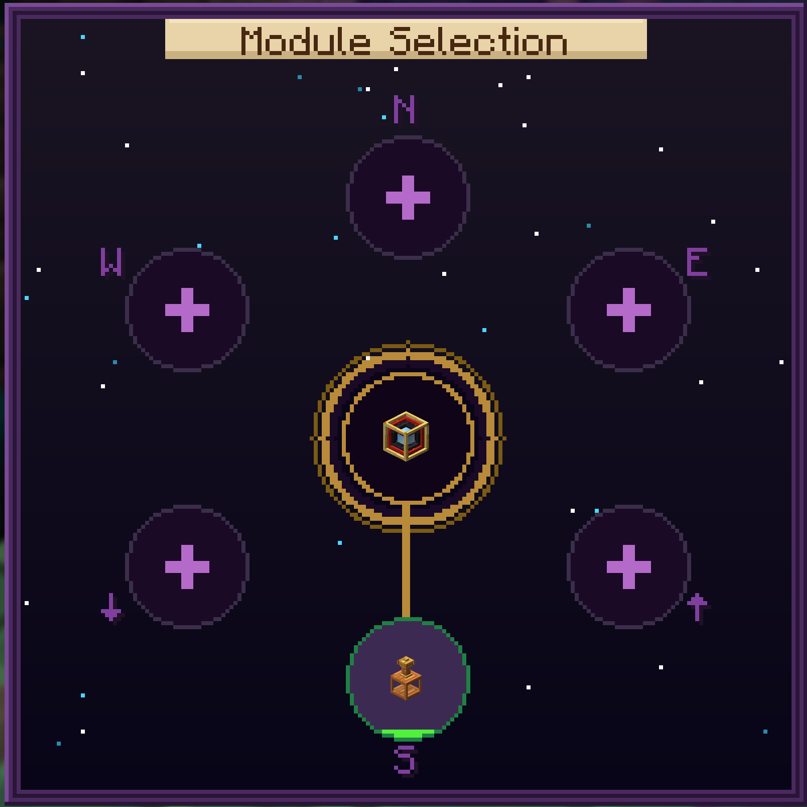
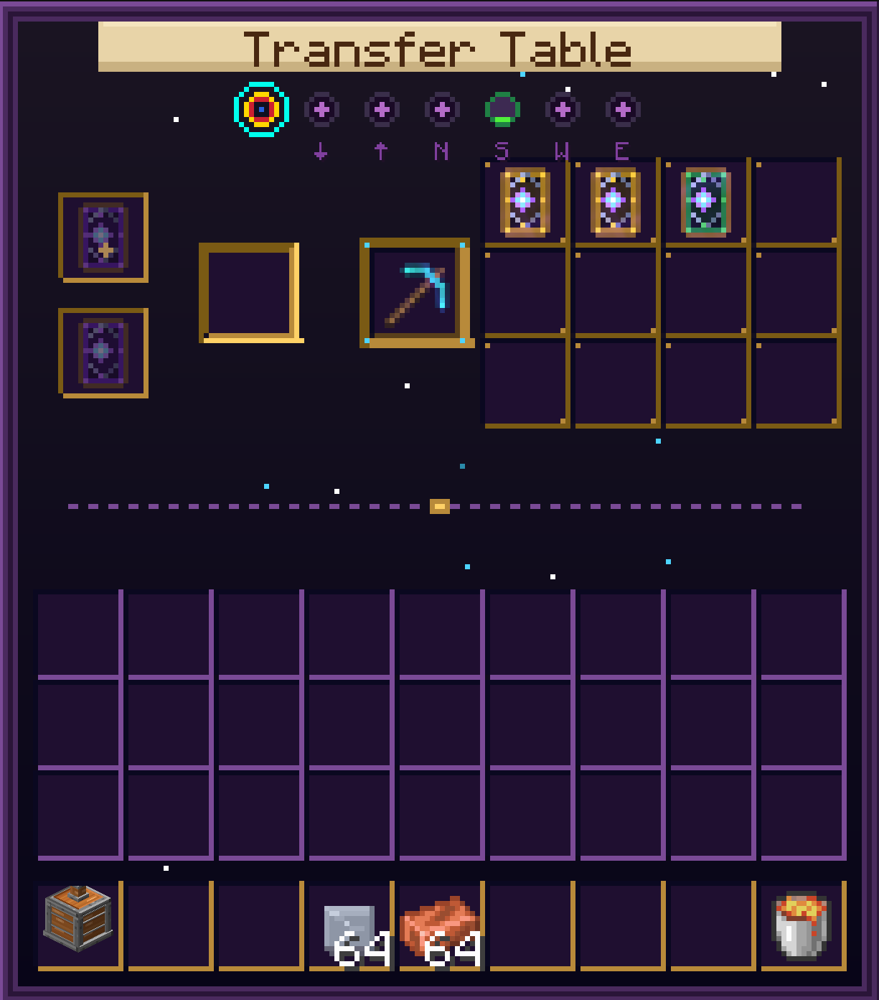
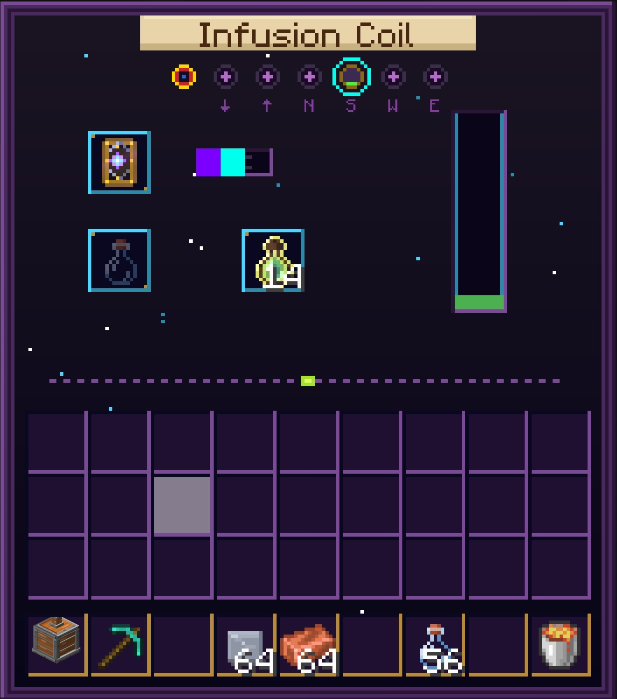
</p>

*From left to right: Selector (hub with module sockets), Transfer Table Core (enchantment operations), Infusion Coil (XP conversion). Dynamic elements like wires, tank fills, and module icons are drawn by code on top of these backgrounds.*

---

## Infusion Coil

The first module for the Transfer Table. A vertical flask made of copper, brass, and glass that converts Magic Cards into XP.

### How it works

1. **Insert** a Magic Card into the card slot — the coil processes it over ~10 seconds
2. **XP is stored** in an internal tank (1,000 XP capacity)
3. **Place glass bottles** in the bottle slot to extract XP as Bottles o' Enchanting (7 XP per bottle)

Unenchanted cards yield a minimum of 5 XP; enchanted cards yield more based on their enchantment.

> **Tip:** The Infusion Coil stays vertical regardless of which face it's attached to. The copper connector stub always points toward the Transfer Table.

### Crafting Recipe

|   |   |   |
|:-:|:-:|:-:|
| <br>Brass Ingot | <br>Amethyst Shard | <br>Brass Ingot |
| <br>Copper Ingot | <br>Glass Block | <br>Copper Ingot |
| <br>Copper Ingot | <br>Copper Ingot | <br>Copper Ingot |

→  **Infusion Coil** × 1

---

## Zinc Smelter

A standalone steampunk furnace for zinc processing and brass alloy creation. An ornate kiln made of copper, brass, and iron with a glass viewport and chimney.

### New Materials

 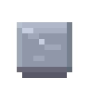 

### Processing Chain

Three smelting recipes form a material chain that produces **Brass Ingots** — required to craft the Infusion Coil.

| Step | Input(s) | Output |
|------|----------|--------|
| 1. Calcination | Calcite | Zinc Oxide ×2 |
| 2. Reduction | Zinc Oxide + Coal | Zinc Sheet |
| 3. Alloying | Copper Ingot + Zinc Sheet | Brass Ingot |

### Crafting Recipe

|   |   |   |
|:-:|:-:|:-:|
| <br>Iron Ingot | <br>Iron Ingot | <br>Iron Ingot |
| <br>Copper Ingot | <br>Glass Pane | <br>Copper Ingot |
| <br>Copper Ingot | <br>Blast Furnace | <br>Copper Ingot |

→ 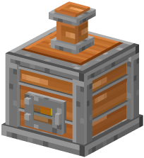 **Zinc Smelter** × 1

### Fuel

The Zinc Smelter only accepts **Lava Buckets** and **Blaze Rods** as fuel — no coal or wood. Lava Buckets return an empty bucket after consumption.

### GUI

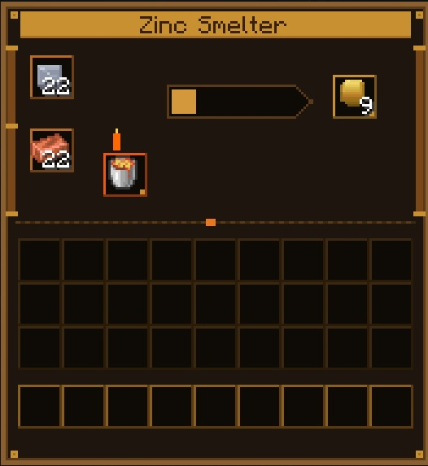

*Steampunk-themed interface with copper input slots, a lava-bordered fuel slot, and brass output slot.*

---

## Transfer Table

### Crafting Recipe

|   |   |   |
|:-:|:-:|:-:|
| <br>Gold Ingot | <br>Gold Ingot | <br>Gold Ingot |
| <br>Redstone Dust | <br>Redstone Dust | <br>Redstone Dust |
| <br>Coal / Charcoal | <br>Diamond | <br>Coal / Charcoal |

→  **Transfer Table** × 1

Requires an **iron pickaxe** or better to mine (the same applies to the Infusion Coil and the Zinc Smelter).

The 3D model reflects its recipe — gold on the outer edge, redstone in the middle ring, carbon-black inner layer, and a blue diamond core that glows from every angle.

---

## Compatibility

> **Worlds from 3.0.x are fully compatible:** nothing in them changes, and an Enchanting Table without Deck Lecterns nearby works exactly like vanilla. Cards extracted before 3.1 keep their color (e.g. yellow Mending, green Soul Speed, or blank Knockback cards) but still go into the deck of their current category — decks check the enchantment, not the card color.

> **Worlds from 1.0.x are fully compatible.** Existing Transfer Tables keep working — the block ID hasn't changed. Old Magic Cards stored in chests retain their enchantment data. They will appear as the generic (blank) card variant; their functionality is unchanged. New cards extracted after updating will automatically use the color-coded system.

---

## Changelog — 3.2.x

### 3.2.0

- **Magnetism** — New Utility enchantment (I–V) for metal armor: pulls nearby items and XP orbs toward you (4 to 12 blocks). Sneak to switch it off
- **Harvesting** — New Nature enchantment (I–IV) for hoes and axes. Hoe: right-click a ripe crop to harvest and replant it, then a row of 3, the whole field (0.5 XP levels per 9×9) and bone meal growth. Axe: replant the sapling, then fell the trunk, the whole tree (0.5 XP levels) and grow the sapling back with bone meal. It spends a seed or sapling from your inventory per plant, and only fells natural trees
- **Crops and trees from other mods** — Harvesting works with other mods' crops out of the box, and their trees through datapack rules in `data/<namespace>/enchanttransfer/harvesting_sapling/` or the `_log` → `_sapling` naming convention
- **Shift + click at the Transfer Table** — A card goes straight onto the item when it fits; otherwise the stack is split evenly into both combine slots. Colored cards can now be shift-clicked too
- **Zinc Smelter drops itself** — It dropped nothing when mined; it now drops with an iron pickaxe or better
- **Card categories reviewed** — Each color now has a clear theme: bow and crossbow attacks (Power, Punch, Multishot, Piercing) move to **Combat**; Fire Aspect, Flame and Infinity move to **Arcane**, which now means magic (fire, ice, lightning, wind, souls, experience) rather than "treasure"; Swift Sneak moves to **Utility** (speed and durability). Cards already extracted keep their color; take them out of their old deck and they go into the new one
- **Configurable XP cost** — Game rules `enchanttransfer:harvesting_field_xp_cost` and `enchanttransfer:harvesting_tree_xp_cost` (0.5 levels by default; 0 makes them free, any higher value works)
- **Plains affinity** — Nature decks favor Harvesting ×1.5 at tables in plains (`#c:is_plains`, so modded plains count too)
- **New languages** — French (fr_fr), German (de_de) and Japanese (ja_jp)

<details>
<summary>Previous versions</summary>

### 3.1.2

- **Card reserve** — Decks no longer lose whole cards at random: each card holds a reserve (its points) that marked enchantments wear down gradually, in proportion to the level obtained and to how much each deck kind boosted it. Options the decks can't pay for are disabled
- **Exact bonus from max-level cards** — Every card favors its category; only max-level cards favor their exact enchantment
- **Rarity wildcard** — Only favors and is only worn by rare enchantments (Fortune, Looting, Silk Touch, Thorns…)
- **Stronger deck bonus** — The category part and the exact-enchantment part now multiply (category up to ×3, exact up to ×15 in all), and strength builds up with the points stored — fast at first, so even a few level I cards show, and in full with one full deck
- **Deck screen** — Right-click with a deck in hand to open it and organize its cards at a glance; the deck's tooltip shows its reserve and each worn card's
- **Lectern contribution** — The amethyst gem's tooltip in the lectern screen shows what its decks give a table, next to each maximum
- **Deck Lectern = two bookshelves** — A full lectern now counts as the two bookshelves stacked in its column. It only counts at the table's own height, and nothing can be placed on top of it
- **Influence mark** — Enchanting Table options changed by the decks show a small card and an "Influenced by card decks" tooltip line

### 3.1.1

- **Translatable tooltips** — Module tooltips in the Selector, Transfer Table and Infusion Coil screens (empty sockets, directions, XP level, Idle/Infusing) are no longer hardcoded in English
- **New languages** — Simplified Chinese (zh_cn), Brazilian Portuguese (pt_br) and Russian (ru_ru)

### 3.1.0

- **Card Decks** — New brass-bound decks that store Magic Cards of one type: Protection, Nature, Combat, Utility, Arcane, and a Rarity wildcard filled with Curse cards. Crafted with 2 Brass Ingots, 2 Leather and 1 card of the deck's type (the card is consumed). Store and take cards with right-click, like a bundle
- **Deck Lectern** — New block that holds 3 decks on a tilted tray under a glass bell. A lamp per slot shows whether each deck has cards, and Shift + right-click toggles it (the amethyst on top glows while active). Every 3 decks holding cards count as one bookshelf of enchanting power, adding up with regular bookshelves (vanilla cap of 15 still applies)
- **Steered enchanting** — Decks make the table favor their category, and even more the exact enchantments stored (up to ×3 with a specialized library). The Rarity wildcard favors rare, low-weight enchantments
- **Location affinity** — Decks resonate with where the table is: Combat ×2 in the Nether (Fire Aspect ×3), fire protections and Flame ×1.5 in the Nether, Arcane ×2 in the End, Nature's water enchantments in oceans and rivers, Fortune and Silk Touch in forests, jungles and taigas
- **Datapack-driven affinities** — Affinity rules are JSON files in `data/<namespace>/enchanttransfer/library_affinity/`, so modpacks can add rules for any dimension or biome; they reload with `/reload`
- **Deck wear** — Each enchantment the library helps with has a 20% chance to consume the cheapest matching card
- **26.2 enchantments categorized** — Knockback, Density, Breach, Lunge, Flame, Multishot, Piercing, Quick Charge, Luck of the Sea, Lure and Wind Burst now have card colors
- **Arcane = rare magic** — All treasure enchantments (Mending, Swift Sneak, Soul Speed, Frost Walker, Wind Burst) are now Arcane cards. Cards already extracted keep their color and still go into the matching deck
- **Lighter website** — 3D block previews are now static images, much faster on phones

### 3.0.0

- **Port to Minecraft 26.2** — Built against Fabric Loader 0.19.3 and Fabric API 0.158.0+26.2
- **Java 25 required** — Minecraft 26.2 needs Java 25 (the 1.21.11 version keeps using Java 21)
- **Official Mojang mappings** — Codebase migrated from Yarn to Mojang mappings (Fabric Loom 1.17)
- **New render pipeline** — Block entity renderers (Transfer Table, Infusion Coil, Zinc Smelter) and all GUI screens migrated to the 26.2 deferred rendering system
- **Translucent blocks** — Infusion Coil and Zinc Smelter now declare their translucent render type in their block models
- **Fabric API dependency** — Declared with the new `fabric-api` mod id (26.2 no longer provides the legacy `fabric` id)
- **Creative tab** — The mod's creative tab is now populated correctly on 26.2
- **No gameplay changes** — Same blocks, items, recipes, and mechanics as 2.0.2

### 2.0.2

- Zinc Smelter can now be mined with a pickaxe; hardness adjusted

### 2.0.1

- Added recipe book advancements for all crafting recipes

### 2.0.0

- **Module System** — The Transfer Table is now a modular hub that accepts specialized blocks on any of its 6 faces
- **Infusion Coil** — First module: converts Magic Cards into XP, fills glass bottles into Bottles o' Enchanting
- **Zinc Smelter** — Steampunk furnace for zinc processing: Calcite → Zinc Oxide → Zinc Sheet → Brass Ingot
- **New Materials** — Zinc Oxide, Zinc Sheet, and Brass Ingot with custom textures and item models
- **Typed Magic Cards** — 6 color-coded card variants by enchantment category (Protection, Nature, Combat, Utility, Arcane, Curse)
- **Selector Screen** — New hub GUI with live module status, wires, and processing indicators
- **Redesigned GUIs** — Dark starry aesthetic, golden/cyan accents, navigation dot bar, ghost input hints
- **New 3D models** — Custom Transfer Table model with stepped funnel and emissive diamond core; Infusion Coil flask with copper/brass/glass and fluid renderer
- **Block Entity Renderers** — Pulsing blue core for the Transfer Table; fluid fill animation, cap glow, and directional connector for the Infusion Coil

### 1.0.3

- Fixed block drop loot table, item translation key, and lang cleanup
- Updated Gradle wrapper to 9.5.0

### 1.0.2

- Migrated data pack paths to 1.21.4+ singular format (recipe/, loot_table/, tags/)
- Broadened minecraft version constraint to >=1.21.1

### 1.0.1

- Port to Minecraft 1.21.11
- Updated Fabric Loom to 1.14, Gradle to 9.2.0, Fabric API to 0.141.4+1.21.11
- Fixed all 1.21.4+ API changes (RegistryKey, DrawContext, ActionResult, etc.)

### 1.0.0

- Migrated to Minecraft 1.21.1 with CI/CD and release automation

</details>

---

## Installation

<!-- AUTO:installation -->
### Minecraft 26.2 — mod v3.1.x

1. Make sure Minecraft runs with **Java 25**
2. Install [Fabric Loader](https://fabricmc.net/use/) **≥ 0.19.3** for Minecraft 26.2
3. Download [Fabric API](https://modrinth.com/mod/fabric-api) for 26.2 and place it in the `mods/` folder
4. Download the Enchant Transfer **3.1.x** JAR and place it in `mods/` as well
5. Launch Minecraft with the Fabric profile

### Minecraft 1.21.11 — mod v2.0.x (maintenance)

1. Make sure Minecraft runs with **Java 21**
2. Install [Fabric Loader](https://fabricmc.net/use/) **≥ 0.19.2** for Minecraft 1.21.11
3. Download [Fabric API](https://modrinth.com/mod/fabric-api) for 1.21.11 and place it in the `mods/` folder
4. Download the Enchant Transfer **2.0.x** JAR and place it in `mods/` as well
5. Launch Minecraft with the Fabric profile

> **Fabric API is required.** The mod will not start without it. Make sure the mod JAR, Fabric API, and Fabric Loader all match your Minecraft version.
<!-- /AUTO:installation -->

---

## Requirements

<!-- AUTO:requirements -->
| Dependency | Minecraft 26.2 (v3.1.x) | Minecraft 1.21.11 (v2.0.x) |
|------------|-------------------------|----------------------------|
| Java | 25 | 21 |
| Fabric Loader | ≥ 0.19.3 | ≥ 0.19.2 |
| Fabric API | 0.158.0+26.2 | 0.141.4+1.21.11 |
<!-- /AUTO:requirements -->

---

## For Developers

### IDE Setup (IntelliJ IDEA)

1. Install the **Minecraft Development** plugin
2. Change build mode:
   - `Settings` → `Build, Execution, Deployment` → `Build Tools` → `Gradle`
   - `Build and run using` → **IntelliJ IDEA**
   - `Run test using` → **IntelliJ IDEA**
3. Set compiler output:
   - `File` → `Project Structure` → `Project Settings` → `Project`
   - `Project compiler output` → `$PROJECT_DIR$/out`

### Gradle Tasks

| Task | Description |
|------|-------------|
| `./gradlew build` | Compile and generate JAR in `build/libs/` |
| `./gradlew runClient` | Launch Minecraft with the mod loaded (client) |
| `./gradlew runServer` | Launch a Minecraft server with the mod |

> `runClient` and `runServer` don't require a separate Minecraft installation; Fabric Loom downloads assets automatically.

### Updating Dependencies

<!-- AUTO:gradle-properties -->
All versions are centralized in `gradle.properties` (current values on `master`, Minecraft 26.2):

```properties
# Java version required to build and run this mod
java_version=25

# Fabric Properties
minecraft_version = 26.2
loader_version=0.19.3
loom_version=1.17-SNAPSHOT

# Dependencies
fabric_version=0.158.0+26.2
```

> Minecraft 26.2 uses the official **Mojang mappings**, so there is no `yarn_mappings` property. The 1.21.11 version (tag `v2.0.2`) uses Yarn (`yarn_mappings=1.21.11+build.3`), Fabric Loom 1.14, and Java 21.
<!-- /AUTO:gradle-properties -->

Reference: https://fabricmc.net/versions.html

### Release Docs Automation

Version numbers in this README and the website (`docs/index.html`) live inside `<!-- AUTO:... -->` blocks; the store description (`docs/curseforge-modrinth-description.md`, used for both Modrinth and CurseForge) is regenerated from this README. They are generated by `scripts/sync-release-docs.py` from:

- **Active line:** `gradle.properties` and `build.gradle` on `master`
- **Maintenance line:** the latest tag matching `v2.0.*` (configurable with `MAINTENANCE_TAG_GLOB`)

The release workflows (`pr-automation.yml` and `manual-release.yml`) run it right after bumping `mod_version`, so the updated docs are part of the tagged release commit, and then redeploy the website. Don't edit the `AUTO` blocks by hand; the changelog and the rest of the text are still written manually.

`docs/curseforge-modrinth-description.md` is generated from this README (absolute image URLs, no "For Developers" section). The sync script regenerates it too.

```bash
python3 scripts/sync-release-docs.py          # update the docs locally
python3 scripts/sync-release-docs.py --check  # exit 1 if they are out of date
```

---

## License

This project is distributed under the **CC0-1.0** license. You may use, modify, and distribute the code without restrictions.
